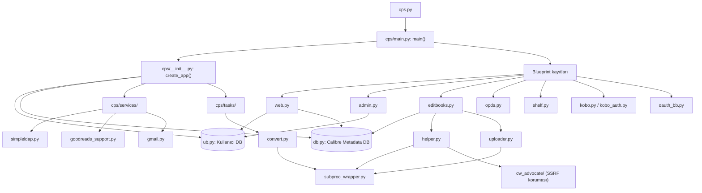

# Mimari Genel Bakış — Calibre-Web

Bu doküman, kod **çalıştırılmadan**, yalnızca kaynak dosyalar okunarak hazırlanmıştır. Amaç, statik analiz bulgularını (Bandit/Pylint/flake8) doğru dosya/fonksiyon bağlamına yerleştirebilmek için uygulamanın genel yapısını ve istek akışlarını açıklamaktır.

## 1. Dizin yapısı

### `cps/` altındaki klasörler

| Klasör | Görevi |
| --- | --- |
| `cps/services/` | İsteğe bağlı/dış servis entegrasyonları: LDAP girişi (`simpleldap.py`), Goodreads metadata (`goodreads_support.py`), Gmail OAuth2 ile e-posta gönderimi (`gmail.py`), Kobo senkron token'ı (`SyncToken.py`), arka plan zamanlayıcı ve worker thread (`background_scheduler.py`, `worker.py`). Her biri `try/except ImportError` ile korumalı; paket kurulu değilse ilgili özellik sessizce devre dışı kalır (bkz. bölüm 3). |
| `cps/tasks/` | Worker thread üzerinde çalışan arka plan görevleri: e-kitap dönüştürme (`convert.py`), yükleme sonrası işler (`upload.py`), e-posta gönderimi (`mail.py`), metadata yedekleme (`metadata_backup.py`), kapak/thumbnail üretimi (`thumbnail.py`), veritabanı/önbellek temizliği (`clean.py`, `database.py`). |
| `cps/cw_login/` | Flask-Login'in projeye gömülü (vendored) kendi kopyası/çatalı — oturum/"remember me" çerezi, `UserMixin`, `AnonymousUserMixin`, login sinyalleri. |
| `cps/cw_advocate/` | "Advocate" kütüphanesinin gömülü kopyası (Apache 2.0, ayrı lisans) — kullanıcının verdiği bir URL'den (örn. kapak resmi) içerik çekerken SSRF'e (sunucunun iç ağa/localhost'a yönlendirilmesine) karşı adres doğrulaması yapan `requests` sarmalayıcısı. |
| `cps/metadata_provider/` | Harici metadata kaynaklarıyla entegrasyon: Amazon, Google, Douban, Comicvine, Lubimyczytac, Google Scholar. |
| `cps/static/` | JS/CSS statik dosyaları. Python statik analiz kapsamı dışı (K1). |
| `cps/templates/` | OPDS/besleme (feed) şablonları (`feed.xml`, `index.xml`, `fragment.html`, `image.html`, `json.txt`) — ana kullanıcı arayüzü değil, makine tarafından okunan çıktı biçimleri. |
| `cps/themes/` | Flask-Themes2 ile yüklenen ana HTML kullanıcı arayüzü şablonları. Python statik analiz kapsamı dışı (K1). |
| `cps/translations/` | Çok dilli arayüz için `.po`/`.mo` çeviri dosyaları (20+ dil). Python statik analiz kapsamı dışı (K1). |

### `cps/` kök dizinindeki başlıca modüller (tam liste değil, en önemlileri)

| Dosya | Görevi |
| --- | --- |
| `cps/__init__.py` | Flask uygulamasını (`app`) ve paylaşılan servis örneklerini (`calibre_db`, `web_server`, `limiter`, `lm`, `config`, `cli_param`, `csrf`, `log`) paket seviyesinde tanımlar; `create_app()` fonksiyonu burada. |
| `cps/main.py` | `main()` — uygulamayı kurar, tüm Blueprint'leri kaydeder, web sunucusunu başlatır. |
| `cps/server.py` | `WebServer` sınıfı — Tornado/gevent tabanlı WSGI sunucusunun başlatılması/durdurulması. |
| `cps/web.py` | Ana kullanıcı arayüzü rotaları: giriş/çıkış, kitap listeleme, indirme, e-okuyucuya gönderme. |
| `cps/admin.py` | Yönetici paneli rotaları: kullanıcı/yapılandırma yönetimi, `admin_required` dekoratörü. |
| `cps/editbooks.py` | Kitap yükleme, düzenleme, dönüştürme tetikleme rotaları. |
| `cps/opds.py` | OPDS besleme uç noktaları (e-okuyucu uygulamaları için). |
| `cps/shelf.py` | Kullanıcı kitaplık rafları (shelves). |
| `cps/kobo.py`, `cps/kobo_auth.py` | Kobo cihaz senkronizasyonu ve Kobo'ya özel kimlik doğrulama. |
| `cps/remotelogin.py` | "Magic Link" uzaktan/mobil giriş akışı. |
| `cps/oauth.py`, `cps/oauth_bb.py` | Google/GitHub OAuth girişi (Flask-Dance tabanlı, `oauth_bb.py` blueprint'i kurar). |
| `cps/usermanagement.py` | Parola doğrulama ve giriş zorunluluğu dekoratörleri (`user_login_required`, `login_required_if_no_ano`), ters proxy başlığından kullanıcı yükleme. |
| `cps/ub.py` | Kullanıcı veritabanı modelleri ve oturum/parola işlemleri (bkz. bölüm 3). |
| `cps/db.py` | Calibre metadata veritabanı modelleri ve sorgu katmanı `CalibreDB` (bkz. bölüm 3). |
| `cps/helper.py` | Dosya indirme/dönüştürme/dizin yapısı, kapak URL'sinden indirme gibi geniş bir yardımcı fonksiyon kümesi. |
| `cps/file_helper.py` | Dosya adı/uzantı/geçici dosya yardımcıları. |
| `cps/uploader.py` | Yüklenen dosyanın geçici konuma kaydedilmesi ve format algılama (`process()`, `upload()`). |
| `cps/subproc_wrapper.py` | Tüm harici süreç (calibre/unrar binary) çağrılarının tek merkezi sarmalayıcısı. |
| `cps/converter.py`, `cps/embed_helper.py` | Calibre dönüştürme/metadata gömme komutlarının hazırlanması. |
| `cps/gdrive.py`, `cps/gdriveutils.py` | Google Drive entegrasyonu (kitaplık Drive'da tutuluyorsa). |
| `cps/config_sql.py` | Uygulama yapılandırmasının veritabanında saklanması, ikili dosya yolu/doğrulama ayarları. |
| `cps/constants.py` | Sabitler: dosya uzantıları, giriş türleri (`LOGIN_LDAP` vb.), yol sabitleri. |
| `cps/updater.py` | Kendi kendini güncelleme kontrolü. |
| `cps/cli.py` | Komut satırı parametreleri. |
| `cps/logger.py` | Merkezi günlükleme kurulumu. |

> **CLAUDE.md dosya adları doğrulandı:** Manuel inceleme odakları bölümünde (3. ve 4. kişi) adı geçen tüm dosyalar (`usermanagement.py`, `web.py`, `admin.py`, `ub.py`, `oauth.py`/`oauth_bb.py`, `kobo_auth.py`, `remotelogin.py`, `uploader.py`, `editbooks.py`, `helper.py`, `file_helper.py`, `tasks/convert.py`, `subproc_wrapper.py`, `gdriveutils.py`, `updater.py`) bu commit'te (`6e840acb...`) birebir mevcuttur; düzeltme gerekmedi.

## 2. Uygulamanın başlangıcı

```
cps.py (__main__)
  └─ cps.main.main()                      [cps/main.py]
       ├─ app = create_app()              [cps/__init__.py] — Flask app, DB bağlantıları,
       │                                    config yükleme, CSRF/oturum ayarları, Flask-Login,
       │                                    Babel (i18n), LDAP/Goodreads servis başlatma,
       │                                    rate limiter, zamanlanmış görevler
       ├─ init_errorhandler()             [cps/error_handler.py]
       ├─ app.register_blueprint(...)     ← TÜM Blueprint kayıtları burada, main() içinde
       │     (search, tasks, web, basic, opds, jinjia, about, shelf, admin,
       │      remotelogin, meta, gdrive, editbook, [kobo, kobo_auth], [oauth])
       └─ web_server.start()              [cps/server.py] — WSGI sunucusunu başlatır
```

Önemli nokta: Blueprint kayıtları **`create_app()` içinde değil**, `cps/main.py:main()` içinde, `create_app()` döndükten sonra yapılır. `kobo` ve `oauth` blueprint'leri yalnızca ilgili bağımlılıklar kuruluysa (`try/except ImportError`) koşullu olarak kaydedilir.

## 3. Katmanlar

| Katman | Dosya(lar) | Sorumluluk |
| --- | --- | --- |
| **Web/route** | `cps/web.py`, `cps/admin.py`, `cps/editbooks.py`, `cps/opds.py`, `cps/shelf.py`, `cps/kobo.py`, vb. | HTTP istek/yanıt, Flask Blueprint rotaları, form/giriş doğrulama, yetki dekoratörleri. |
| **Kullanıcı veritabanı** | `cps/ub.py` | SQLAlchemy modelleri: `User`, `Anonymous`, `Shelf`, `Downloads`, `User_Sessions`, `RemoteAuthToken`, Kobo senkron tabloları. Parola/oturum işlemleri (`password_change`, `store_user_session`, `check_user_session`). Ayrı bir SQLite veritabanıdır (`app.db`), Calibre kitaplığından bağımsız. |
| **Calibre metadata veritabanı** | `cps/db.py` | SQLAlchemy modelleri: `Books`, `Authors`, `Tags`, `Series`, `Identifiers`, `CustomColumns` vb. — Calibre'nin kendi `metadata.db` dosyasını **salt yapı itibariyle** yansıtır. Sorgu/filtreleme katmanı `CalibreDB` sınıfıdır. |
| **Servisler** | `cps/services/` | Çekirdek işi değil, isteğe bağlı dış entegrasyonlar: LDAP, Goodreads, Gmail, Kobo SyncToken, arka plan zamanlayıcı. `cps/services/__init__.py`, her birini `try/except ImportError` ile yükler; başarısız olursa ilgili değişkeni (`ldap`, `goodreads_support`, `gmail`) `None` yapar — uygulama çökmez, özellik sessizce kapanır. |
| **Arka plan görevleri** | `cps/tasks/` + `cps/services/worker.py` | `WorkerThread` üzerinden kuyruğa alınan uzun süren işler (dönüştürme, e-posta gönderimi, metadata yedekleme, thumbnail üretimi). Web katmanı bu işleri tetikler ama senkron olarak beklemez. |

## 4. Örnek istek akışları

### 4.1 Kitap indirme

```
GET /download/<book_id>/<book_format>
  cps/web.py:download_link()                       (satır ~1251)
    └─ cps/helper.py:get_download_link()            (satır 1106)
         ├─ calibre_db.get_filtered_book(...)        [cps/db.py]
         ├─ calibre_db.get_book_format(...)          [cps/db.py]
         ├─ ub.update_download(...)                  [cps/ub.py] (giriş yapmış kullanıcı için)
         ├─ get_valid_filename(...)                  [cps/helper.py] — dosya adını güvenli hale getirir
         └─ cps/helper.py:do_download_file()         (satır 921)
              ├─ (Google Drive ise) gdriveutils.getFileFromEbooksFolder/do_gdrive_download
              ├─ os.path.join(config.get_book_path(), book.path)  — dosya yolu kitaplık köküne göre kurulur
              └─ flask.send_from_directory(filename, download_name + "." + book_format)
                    (Werkzeug'un kendi path-traversal koruması burada devreye girer)
```

### 4.2 Kitap yükleme

```
POST /upload
  cps/editbooks.py:upload()                         (satır 108)
    ├─ cps/editbooks.py:file_handling_on_upload()    (satır 971)
    │    ├─ validate_mime_type(...)                  [cps/file_helper.py, satır 63] — içerik türü kontrolü
    │    └─ cps/uploader.py:upload()                 (satır 277)
    │         ├─ hashlib.md5(filename) → geçici dosya adı                    # nosec (mevcut upstream kodu)
    │         ├─ uploadfile.save(tmp_file_path)       — Flask/Werkzeug geçici dizine kaydeder
    │         └─ cps/uploader.py:process()            (satır 90) — biçime göre metadata/kapak çıkarımı
    ├─ cps/editbooks.py:create_book_on_upload()       (satır 908) — veritabanına kayıt
    ├─ cps/helper.py:update_dir_structure()           (satır 695) — kitaplık dizin ağacına taşıma
    │    └─ cps/helper.py:update_dir_structure_file()  (satır 451) — dosya adı/dizin birleştirme
    ├─ cps/editbooks.py:move_coverfile()               (satır 1002) — kapak dosyasını taşır
    └─ calibre_db.session.commit()                    [cps/db.py]
```

## 5. Güvenlik açısından kritik bölgeler haritası

### 5.1 Kimlik doğrulama / yetki (3. kişi)

| Dosya | Fonksiyon/sınıf | Neden kritik |
| --- | --- | --- |
| `cps/usermanagement.py` | `verify_password`, `login_required_if_no_ano`, `user_login_required`, `load_user_from_reverse_proxy_header`, `_has_valid_reverse_proxy_shared_secret` | Parola doğrulama ve giriş zorunluluğu dekoratörleri; ters proxy başlığına güvenerek kimlik doğrulama (header spoofing riski). |
| `cps/web.py` | `login()`, `login_post()`, `logout()` (satır 1380–1459) | Ana giriş/çıkış akışı; oran sınırlama (`limiter.limit`), LDAP/yerel parola düşüşü (fallback), parola karşılaştırma (`check_password_hash`). |
| `cps/admin.py` | `admin_required` (satır 95) | Yönetici yetkisi dekoratörü; tüm `/admin` rotalarının koruyucusu. |
| `cps/ub.py` | `UserBase.role_admin/role_download/role_upload/role_edit/...` (satır ~148–172), `User`, `Anonymous`, `password_change` | Rol/izin modeli ve parola değişim mantığının bulunduğu yer; parola özetleri (`password` alanı, `werkzeug.security`). |
| `cps/oauth.py`, `cps/oauth_bb.py` | OAuth blueprint ve geri çağırma (callback) rotaları | Üçüncü taraf kimlik sağlayıcılarıyla oturum eşleştirmesi. |
| `cps/kobo_auth.py` | Kobo'ya özel token tabanlı kimlik doğrulama | Cihaz senkronizasyonu için ayrı bir kimlik doğrulama yolu. |
| `cps/remotelogin.py` | "Magic Link" uzaktan giriş | Parolasız, token tabanlı alternatif giriş yolu. |
| `cps/services/simpleldap.py` | LDAP bağlama (`bind_user`) | Harici dizin sunucusuna kimlik bilgisi iletimi; bu ortamda `flask_simpleldap` eksik olduğundan test edilemedi (bkz. bölüm 6 ve `docs/environment-notes.md`). |
| `cps/__init__.py` | Oturum çerezi ayarları (satır 88–95: `SESSION_COOKIE_HTTPONLY`, `SESSION_COOKIE_SAMESITE`, `WTF_CSRF_SSL_STRICT=False`), `CSRFProtect` kurulumu (satır 103–106, 129–130) | Oturum/CSRF güvenlik ayarlarının merkezi tanımı. `WTF_CSRF_SSL_STRICT=False` özellikle incelenmeye değer. |

### 5.2 Dosya işleme ve harici süreç çağrıları (4. kişi)

| Dosya | Fonksiyon | Neden kritik |
| --- | --- | --- |
| `cps/uploader.py` | `upload()` (277), `process()` (90) | Kullanıcıdan gelen dosyanın diske yazılması; dosya adı yerine MD5 özeti kullanılarak geçici ad üretimi. |
| `cps/editbooks.py` | `upload()` (108), `file_handling_on_upload()` (971), `move_coverfile()` (1002) | Yükleme uç noktası; MIME/uzantı kontrolü, kapak dosyası taşıma. |
| `cps/helper.py` | `get_download_link()` (1106), `do_download_file()` (921), `update_dir_structure()` (695), `update_dir_structure_file()` (451), `get_valid_filename()`, kapak URL indirme (satır ~832, `cw_advocate.get`) | İndirme yanıtı üretimi, dizin ağacı birleştirme (yol birleştirme riski), kullanıcı URL'sinden kapak indirme (SSRF). |
| `cps/file_helper.py` | Dosya adı/uzantı/geçici dizin yardımcıları (`get_temp_dir` vb.) | Diğer tüm dosya işlemlerinin ortak alt yapısı. |
| `cps/subproc_wrapper.py` | `process_open()` (24), `process_wait()` (39) | **Tüm** harici süreç (Calibre `ebook-convert`, `unrar` vb.) çağrılarının geçtiği tek merkezi nokta; `shell=False` ile çağrılır (`# nosec`, mevcut upstream kodu — K6 kapsamında yeni eklenmedi). |
| `cps/tasks/convert.py` | `process_open()` çağrıları (238, 281, 323) | Kitap formatı dönüştürme komutlarının kurulması ve çalıştırılması. |
| `cps/converter.py`, `cps/embed_helper.py` | `process_wait`/`process_open` çağrıları | Calibre binary sürüm kontrolü ve metadata gömme komutu. |
| `cps/gdriveutils.py` | Google Drive dosya indirme/yükleme | Harici depolama entegrasyonu; kitaplık Drive'da tutulduğunda dosya akışı buradan geçer. |
| `cps/updater.py` | Kendi kendini güncelleme indirme/uygulama mantığı | Uzak sunucudan alınan bir paketin yerel dosya sistemine yazılması. |
| `cps/cw_advocate/` | `get()`, adres doğrulama (`addrvalidator.py`) | SSRF koruması; `cps/helper.py` içinde kapak URL indirmede kullanılır. |

## 6. `E0611 no-name-in-module` notu (ortam sorunu, dinamik atama)

Pylint başlangıç taramasında 252 adet `E0611` uyarısı bulundu (bkz. `docs/pylint-baseline-summary.md`). Bunun **2 adedi** gerçekten eksik bir pakete bağlıdır (`cps/services/simpleldap.py`, `flask_simpleldap` kurulu değil). Kalan **250 adedi** ise kod hatası değildir; `cps/__init__.py`'nin kendisi, alt modülleri ve servis örneklerini **paket seviyesinde adlandırılmış değişkenler** olarak tanımlar:

```python
# cps/__init__.py — paket seviyesinde tanımlanan örnekler
log = logger.create()
...
calibre_db = db.CalibreDB(app)      # "cps.calibre_db" olarak diğer modüllerden erişilir
```

Başka bir modül bunu şöyle kullanır:

```python
# cps/about.py
from . import db, calibre_db, converter, uploader, constants, dep_check
```

Burada `db`, `converter`, `uploader`, `constants`, `dep_check` gerçek alt modül dosyalarıdır (`cps/db.py`, `cps/converter.py` vb.) ve normalde sorunsuz çözümlenmelidir; `calibre_db` ise `__init__.py` içinde tanımlı bir örnektir. Pylint/astroid, paketin kendi `__init__.py`'si **çok sayıda döngüsel import** içerdiğinden (aynı taramada 43 adet `R0401 cyclic-import` bulgusu var; örn. `cps -> cps.ub -> cps.helper -> cps.file_helper`) `cps` paketinin isim tablosunu bazı modüller için eksik/geçici bir anlık görüntü üzerinden değerlendirir ve hem gerçek alt modülleri hem de paket örneklerini "yok" sayabilir. Bu, Pylint/astroid'in döngüsel import + paket-seviyesi dinamik durum örüntüsünü statik olarak çözememesinden kaynaklanan **bilinen bir kısıttır**; çalışma zamanında bu adlar gerçekten mevcuttur ve uygulama çalışır.

**Durum:** Bu 250 uyarı şu an **doğrulanmamış bir yanlış pozitif adayıdır**. Ekip, bulgu envanteri aşamasında (`docs/findings-register.csv`, CLAUDE.md takvimi: 31 Ekim) bu adayı resmî olarak "Yanlış pozitif" durumuna işleyecek veya aksini gösteren bir örnek bulunursa gerekçeyle güncelleyecektir.

## 7. Modüller arası ilişki (basitleştirilmiş)


