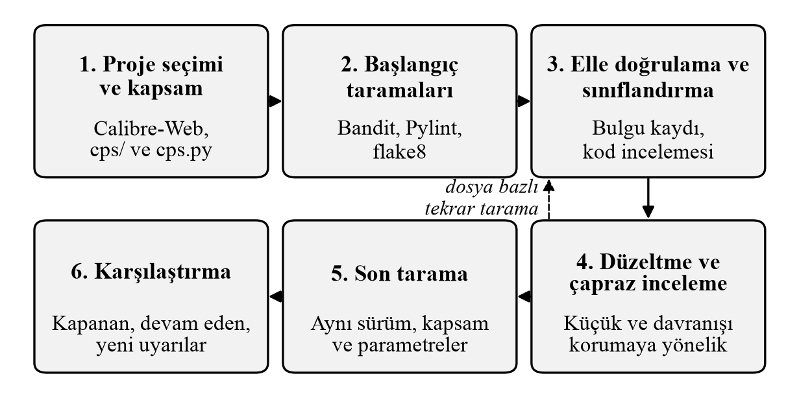
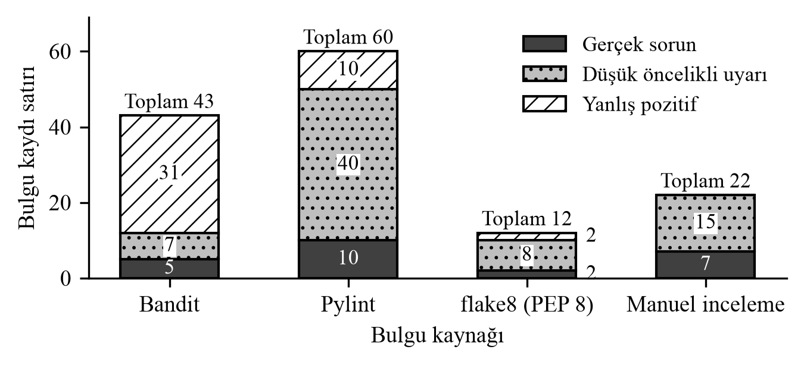
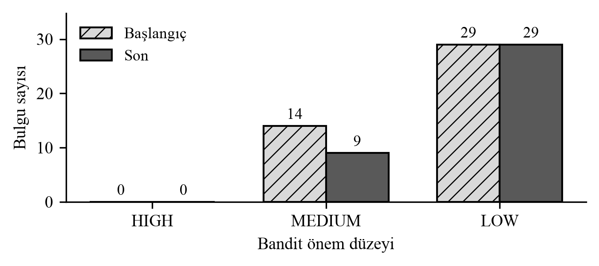
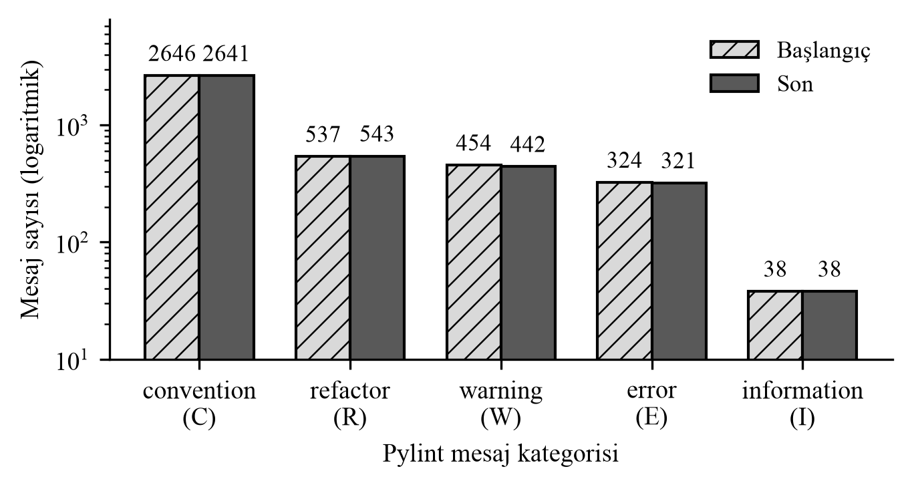
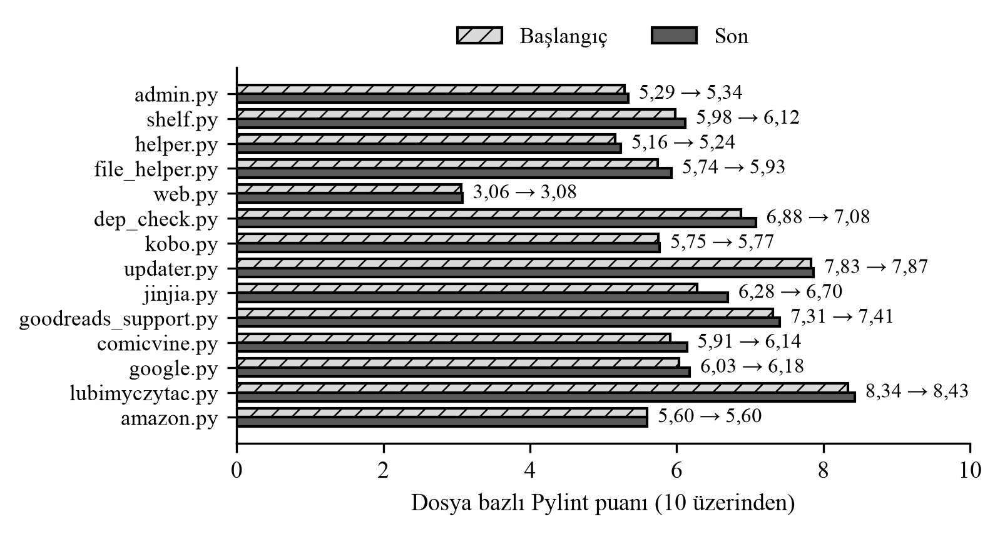

**Proje Başlığı:** Calibre-Web Üzerinde Güvenlik İçin Statik Kod Analizi
**Gruptaki Öğrencilerin Adı – Soyadı:** Şeyda Altın, Dilara Yıldırım, Mustafa Emre Bulut, Muhammed Hasan Kurt
**Gruptaki Öğrencilerin Numarası:** 230290046, 230290018, 230290001, 230290033

# 1. Giriş

**Amaç.** Statik kod analizi, kaynak kodun çalıştırılmadan incelenerek güvenlik riskleri, olası çalışma hataları ve kodlama standardı ihlallerinin bulunmasıdır. Bu projede gerçek ve yeterli büyüklükte bir açık kaynak Python uygulaması Bandit (güvenlik), Pylint (kod kalitesi) ve flake8 (PEP 8) ile incelendi; bulgular elle doğrulandı, seçilen sorunlar düzeltildi ve araçlar aynı koşullarda yeniden çalıştırılarak başlangıç ve son durum karşılaştırıldı.

**İncelenen proje.** Calibre-Web, bir Calibre e-kitap kitaplığını web arayüzü üzerinden tarama, okuma, indirme ve yönetme olanağı sunan Flask tabanlı bir uygulamadır [1]. Proje; kimlik doğrulama, erişim denetimi, dosya işleme, harici süreç çağrısı ve dış ağ isteği gibi web uygulamalarında sık görülen risk alanlarını [2] tek bir kod tabanında bir araya getirdiği için seçildi. Calibre-Web GPL v3 lisanslıdır; lisans dosyası ve kaynak dosyalardaki telif bildirimleri değiştirilmedi. Çalışmanın bütün çıktıları ekip deposunda bulunmaktadır [3].

**Kapsam.** Analiz, Calibre-Web ana deposunun 20 Eylül 2026 tarihli `6e840acb` sürümü (commit) üzerinde yapıldı. Tarama kapsamı uygulama paketi `cps/` ile giriş noktası `cps.py` dosyasıdır; testler, örnek veri, şablonlar ve çeviri dosyaları Python statik analizinin hedefi olmadığından kapsam dışında bırakıldı. Taranan kodun büyüklüğü Tablo 1'de verilmiştir.

**Tablo 1.** Taranan kapsamın büyüklüğü (`cps/` ve `cps.py`, başlangıç sürümü)

| Ölçü | Değer |
| --- | --- |
| Python dosyası | 101 |
| Toplam satır | 37.831 |
| Kod satırı (boş satırlar ve tam satır yorumlar hariç) | 31.597 |

En büyük dosya, dil kodlarını dil adlarına eşleyen otomatik üretilmiş bir sözlük olan `iso_language_names.py`'dir (11.732 satır); büyüklüğü iş mantığını değil veri hacmini yansıtır. Uygulama mantığı ağırlıklı olarak `admin.py` (2.211), `editbooks.py` (1.762), `web.py` (1.675), `kobo.py` (1.320), `db.py` (1.206) ve `helper.py` (1.165) dosyalarında toplanmıştır.

**Mimari yapı.** Uygulama katmanlıdır: rota katmanı HTTP isteklerini karşılar ve yetki denetimlerini dekoratörlerle uygular; `ub.py` kullanıcı ve oturum veritabanını, `db.py` Calibre'nin üst veri veritabanını modeller; `services/` dış entegrasyonları, `tasks/` arka plan işlerini içerir. `cps/cw_login/` ve `cps/cw_advocate/` uygulamaya gömülmüş üçüncü taraf kütüphanelerdir; taramaya dahil edildi, ancak içlerinde düzeltme yapılmadı. Güvenlik açısından kritik modüller Tablo 2'de özetlenmiştir.

**Tablo 2.** Güvenlik açısından kritik modüller

| Modül | Görevi | Güvenlik açısından önemi |
| --- | --- | --- |
| `web.py`, `admin.py`, `editbooks.py` | Kullanıcı, yönetici ve kitap rotaları | Erişim denetimi |
| `usermanagement.py`, `ub.py` | Giriş, parola, oturum, roller | Kimlik doğrulama |
| `uploader.py`, `helper.py`, `file_helper.py` | Yükleme, indirme, arşiv okuma | Dizin geçişi, bozuk arşiv |
| `subproc_wrapper.py`, `tasks/convert.py` | Harici program çağrıları | Komut enjeksiyonu |
| `metadata_provider/`, `services/` | Dış servislerden üst veri | Kaynak tüketimi |

**Problemin tanımı.** Statik analiz araçlarının ürettiği uyarıların bir kısmı yanlış pozitif ya da düşük önceliklidir; bazı gerçek sorunlar ise araçların kurallarına hiç takılmaz. Projenin yanıtladığı soru şudur: Araç çıktısı ile elle yapılan kod incelemesi birlikte kullanıldığında gerçek riskler nasıl ayırt edilir, bunların hangileri küçük ve davranışı korumaya yönelik değişikliklerle düzeltilebilir ve düzeltmelerin etkisi aynı araçlarla nasıl ölçülür?

**Projenin hedefleri.**

- **H1.** Kapsamın başlangıç durumunu, kaynak kodda hiçbir değişiklik yapılmadan önce Bandit, Pylint ve flake8 ile ölçüp kayıt altına almak.
- **H2.** MEDIUM ve HIGH önem düzeyindeki bütün Bandit bulgularını kod satırları üzerinden incelemek.
- **H3.** Kimlik doğrulama/yetki ile dosya işleme/harici süreç/ağ alanlarını elle inceleyerek araçların göremediği sorunları ortaya çıkarmak.
- **H4.** Her bulguyu kodla desteklenen bir gerekçeyle gerçek sorun, düşük öncelikli uyarı veya yanlış pozitif olarak sınıflandırmak.
- **H5.** Seçilen gerçek sorunları davranışı korumaya yönelik küçük değişikliklerle düzeltmek; her düzeltmeyi, yapandan farklı bir ekip üyesine teknik olarak inceletmek.
- **H6.** Araçları aynı sürüm, kapsam ve parametrelerle yeniden çalıştırıp kapanan, devam eden ve yeni oluşan uyarıları ayrı ayrı ölçmek.

# 2. Yöntem

Çalışmanın genel akışı Şekil 1'de gösterilmiştir.



**Şekil 1.** Analiz sürecinin akış diyagramı

- **Araçlar.** Kullanılan araçlar Tablo 3'te verilmiştir. Bandit bilinen güvensiz örüntüleri arayıp her bulguya önem ve güven düzeyi atar [4]; Pylint olası hataları ve biçim kurallarını denetleyip 10 üzerinden puan üretir [5]; flake8 [6] ise kodun PEP 8 [7] kurallarına uygunluğunu denetler.

**Tablo 3.** Kullanılan araçlar ve parametreler

| Araç | Sürüm | Ölçtüğü | Ölçmediği | Parametreler |
| --- | --- | --- | --- | --- |
| Bandit | 1.9.4 | Güvensiz kod örüntüleri; önem × güven | Veri akışı, yetki mantığı | Varsayılan, tüm testler; JSON |
| Pylint | 4.1.3 (astroid 4.3.4) | Olası hatalar, biçim; 10 üzerinden puan | Güvenlik; dinamik öznitelikler | Varsayılan |
| flake8 | 7.4.1 | PEP 8 ihlalleri (E, W) | Kodun anlamı | `--isolated --select=E,W` (79 karakter) |

- **Ortam.** Taramalar Windows üzerinde Python 3.12.10 ile, sürümleri bir kilit dosyasında sabitlenmiş bir sanal ortamda yapıldı. Pylint'in içe aktarmaları çözebilmesi için bağımlılıklar kuruldu; uygulama hiçbir aşamada başlatılmadı. İsteğe bağlı 30 paketten ikisi (`python-ldap`, `Flask-SimpleLDAP`) Windows'ta derlenemedi; bunun sonucu olan 2 `E0401` mesajı ortam kısıtı olarak kaydedildi, LDAP kodu yine tarandı.
- **Değişmeyen başlangıç.** Başlangıç raporları kaynak kodda herhangi bir değişiklik yapılmadan önce depoya eklendi. Başlangıç ve son taramada aynı araç sürümleri, aynı kapsam ve aynı komutlar kullanıldı.
- **Bulgu kaydı.** Bütün bulgular tek bir kayıtta (`docs/findings-register.csv`) tutuldu; her bulguya yeniden kullanılmayan bir kimlik numarası verildi (ör. FIND-014; raporda bulgulara bu numaralarla atıf yapılır) ve doğrulama sonucu, kodla desteklenen gerekçe ve inceleyen kişi yazıldı. 137 satırın 74'ünde inceleyenden farklı bir gözden geçiren vardır; kalan 63 satır düzeltilmeyen Pylint ve flake8 bulgularıdır ve gözden geçiren atanmamıştır.
- **Sınıflandırma ölçütleri.** Her bulgu Tablo 4'teki ölçütlerden birine göre sınıflandırıldı. "Araç uyardığına göre açık vardır" ya da "kimse istismar etmez" gibi kodla desteklenmeyen gerekçeler kabul edilmedi.

**Tablo 4.** Bulgu sınıflandırma ölçütleri

| Sonuç | Verildiği koşul |
| --- | --- |
| Gerçek sorun | Kod yolu izlenerek hatalı ya da kötü niyetli bir girdinin ilgili noktaya ulaşıp zarar verebileceği gösterilebiliyor; kalite bulgularında uyarı gerçek bir çalışma hatasına yol açıyor. |
| Düşük öncelikli uyarı | Sorun teorik olarak var, ancak etkisi küçük, yalnızca yöneticinin erişebildiği bir yerde ya da başka bir korumayla sınırlanmış. |
| Yanlış pozitif | Aracın uyardığı durumun bu kodda oluşamayacağı kodla gösterilebiliyor (ör. değer sabit, girdi önceden temizleniyor, araç dinamik yapıyı çözemiyor). |

- **Düzeltme ilkeleri.** Yalnızca gerçek sorun olarak sınıflandırılan ve seçilen bulgular, davranışı korumaya yönelik küçük değişikliklerle düzeltildi. Hedef en az üç güvenlik bulgusu ve en az beş kod kalitesi/PEP 8 türüydü. Proje otomatik araçlarla (black, autopep8) toplu biçimlendirilmedi; binlerce satırlık bir değişiklik önce-sonra karşılaştırmasını anlamsızlaştırırdı. Bu yaklaşım ders yürütücüsüyle teyit edildi. Uyarıları susturan yorumlar (`# nosec`, `# noqa`, `# pylint: disable`) eklenmedi. Gömülü üçüncü taraf dizinlerde düzeltme yapılmadı.
- **Doğrulama.** Üç düzey ayrı tutuldu: (1) sözdizimi — değiştirilen dosyalar `py_compile` ile derlendi; (2) statik analiz — dosyalar üç araçla yeniden tarandı, hedef uyarının kapanması ve yeni uyarı oluşmaması arandı; (3) yalıtılmış deneme — gerektiğinde uygulama başlatılmadan yalnızca ilgili kütüphane işlevi küçük bir Python parçasıyla denendi. Çalışma zamanı testi yapılmadı; davranışın korunduğu kod okuma ve yalıtılmış denemelerle desteklendi, çalışan uygulamada gösterilmedi. Her düzeltme, yapandan farklı bir üye tarafından incelendi ya da GitHub üzerinden onaylandı (Tablo 14).
- **Karşılaştırma yöntemi.** Satır numaraları düzeltmelerle kaydığı için uyarılar "dosya yolu + kural kodu + kaynak satırın metni" anahtarıyla eşleştirildi ve kapanan, devam eden, yeni oluşan olarak sayıldı.
- **Tekrarlanabilirlik.** Son taramalar kod dondurulduktan sonraki `830d3a80` sürümü üzerinde yapıldı. Taramalar ikinci bir ekip üyesince kendi bilgisayarında aynı sürümlerle tekrarlandı; Bandit bulgu sayısı ve önem dağılımı, Pylint puanı ve flake8 ihlal sayısı aynı çıktı (Pylint'in döngüsel içe aktarma mesajı R0401'in çalıştırmalar arasındaki değişkenliği için bkz. Tablo 25).
- **Görev dağılımı.** Katkılar, izlenebilir kanıtlarıyla birlikte Tablo 5'te verilmiştir; doküman yolları ekip deposunun `docs/` klasörüne göredir. Raporda "teknik inceleme" düzeltmenin kod ve araç çıktıları üzerinden yayımlanmış yazılı kontrolünü, "onay" birleştirme isteğine GitHub üzerinden verilen onayı ifade eder.

**Tablo 5.** Görev dağılımı

| Öğrenci | Analiz alanı | Bulgu kaydına katkı | Düzeltmeler | Gözden geçirme / doğrulama | Kaynak doküman / katkı kanıtı |
| --- | --- | --- | --- | --- | --- |
| Şeyda Altın | Kapsam ve mimari; Pylint ve PEP 8; depo yönetimi | Pylint/flake8 bulguları (FIND-045–117); Bandit ve dosya işleme kayıtlarını gözden geçirme | FIND-056, 069, 078, 081, 117 | FIND-126 ve 049 onayı; son taramalar ve karşılaştırma | `1-kapsam/`, `2-baslangic/`, `4-duzeltme/`, `5-karsilastirma/`; Bandit 1.9.4 raporlarının commit'i |
| Dilara Yıldırım | Bandit başlangıç taramaları; B113 analizi ve düzeltme planı | Kaydın sorumluluğu: kimlik dağıtımı, biçim ve bütünlük kontrolü | FIND-010–014, 116 (+085) | Kalite/PEP 8 düzeltmelerinin (FIND-049 dahil) teknik incelemesi; FIND-159 teknik incelemesi; final raporun hazırlanması | `evidence/bandit-1.8.6-original/`, `3-inceleme/review-bandit.md`, `surec/28-ekim-kontrol-dilara.md`, `final-report.md` |
| Mustafa Emre Bulut | Bandit bulgularının değerlendirilmesi; kimlik doğrulama ve yetki | Bandit (FIND-001–044) ve yetki (FIND-125–133) bulguları | FIND-126 (kısmi), 049 | FIND-080 ve 150 teknik incelemesi ve onayı; FIND-159 teknik incelemesi; son taramanın tekrarı | `3-inceleme/review-bandit.md`, `review-auth.md`, `report-part-auth.md`, `surec/environment-notes.md` |
| Muhammed Hasan Kurt | Dosya işleme, harici süreç ve ağ çağrıları | Dosya işleme bulguları (FIND-150–160); yetki kayıtlarını gözden geçirme | FIND-150, 080 (+109) | Zaman aşımı düzeltmesinin teknik incelemesi ve onayı | `3-inceleme/review-file-handling.md`, `report-part-file-handling.md` |

# 3. Uygulama / Geliştirim Aşamaları

Çalışma Şekil 1'deki sırayla yürütüldü: kod değiştirilmeden başlangıç taramaları yapıldı (3.1, 3.2, 3.4), önemli bulgular ve iki kritik alan elle incelendi (3.3), bulgular sınıflandırıldı (3.5) ve seçilen sorunlar düzeltildi (3.6).

## 3.1 Pylint ile başlangıç kalite analizi

Pylint başlangıç taraması 6,42/10 puan ve 3.999 mesaj üretti. Tablo 6'da görüldüğü gibi mesajların yaklaşık üçte ikisi convention (biçim, adlandırma, belgelendirme) mesajıdır.

**Tablo 6.** Pylint başlangıç kategori dağılımı

| Kategori | Adet | Oran |
| --- | --- | --- |
| convention (C) | 2.646 | %66,2 |
| refactor (R) | 537 | %13,4 |
| warning (W) | 454 | %11,4 |
| error (E) | 324 | %8,1 |
| information (I) | 38 | %1,0 |
| **Toplam** | **3.999** | **%100** |

En sık on mesaj kodu Tablo 7'dedir. En çok mesaj alan dosyalar `admin.py` (336), `web.py` (333), `editbooks.py` (255), `helper.py` (218) ve `db.py` (212) oldu.

**Tablo 7.** En sık görülen on Pylint mesaj kodu (C: convention, R: refactor, W: warning, E: error)

| Kod | Ad | Kat. | Adet | Kod | Ad | Kat. | Adet |
| --- | --- | --- | --- | --- | --- | --- | --- |
| C0301 | line-too-long | C | 911 | C0411 | wrong-import-order | C | 105 |
| C0116 | missing-function-docstring | C | 779 | R1705 | no-else-return | R | 96 |
| C0209 | consider-using-f-string | C | 303 | C0114 | missing-module-docstring | C | 92 |
| E0611 | no-name-in-module | E | 252 | C0115 | missing-class-docstring | C | 90 |
| C0103 | invalid-name | C | 209 | W0718 | broad-exception-caught | W | 83 |

Error mesajlarının çoğu gerçek hata değildir: 252 E0611 mesajının 250'si, `cps/__init__.py` dosyasının alt modülleri çalışma zamanında paket özniteliği olarak atamasından doğar; Pylint bu dinamik atamayı izleyemez. Bu mesajlar tek kayıtta yanlış pozitif olarak işlendi (FIND-045). Buna karşılık iki mesaj, kod okunarak doğrulanan gerçek hatalara işaret etti. W1116'da (FIND-081) `isinstance` argümanları ters yazılmıştır; ikinci argüman tür olmadığından hata işleyicisi her çalıştığında `TypeError` fırlatır. E1305'te (FIND-056) tek yer tutuculu dizgiye iki argüman verilir ve aranan dosyanın adı günlük kaydından düşer.

```
cps/helper.py:302
    if isinstance(list, value2):
cps/helper.py:416–417
    log.error("File {} not found on gdrive"
              .format(old_path, file_format.name + '.' + file_format.format.lower()))
```

## 3.2 Bandit ile güvenlik analizi ve risk sınıflandırması

Bandit, `cps/` dizininde 42 ve `cps.py` dosyasında 1 olmak üzere 43 bulgu üretti. Tablo 8'de görüldüğü gibi HIGH önemli bulgu yoktur; 14 bulgu MEDIUM, 29 bulgu LOW önemdedir.

**Tablo 8.** Bandit başlangıç önem × güven matrisi

| Önem \ Güven | HIGH | MEDIUM | LOW | Toplam |
| --- | --- | --- | --- | --- |
| HIGH | 0 | 0 | 0 | 0 |
| MEDIUM | 8 | 1 | 5 | 14 |
| LOW | 19 | 10 | 0 | 29 |
| **Toplam** | **27** | **11** | **5** | **43** |

Kurallara göre dağılım Tablo 9'dadır. B101 bulgularının 9'u gömülü üçüncü taraf kod olan `cps/cw_advocate/` dizinindedir.

**Tablo 9.** Bandit bulgularının kurallara göre dağılımı

| Kural | Açıklama | Önem | Güven | Adet |
| --- | --- | --- | --- | --- |
| B113 | Zaman aşımı olmadan dış HTTP isteği | MEDIUM | LOW | 5 |
| B704 | `Markup` kullanımıyla olası XSS | MEDIUM | HIGH | 4 |
| B103 | Geniş dosya izni (`chmod`) | MEDIUM | HIGH | 2 |
| B307 | `eval` kullanımı | MEDIUM | HIGH | 1 |
| B310 | Şeması denetlenmeyen `urlopen` | MEDIUM | HIGH | 1 |
| B104 | Tüm ağ arayüzlerinde dinleme | MEDIUM | MEDIUM | 1 |
| B101 | `assert` kullanımı | LOW | HIGH | 12 |
| B105 | Sabit parola dizgisi | LOW | MEDIUM | 8 |
| B110 | `try/except/pass` | LOW | HIGH | 4 |
| Diğer | B107, B112, B403, B404, B606 (birer adet) | LOW | HIGH/MEDIUM | 5 |

Kaynak kodda proje geliştiricilerinin önceden eklediği 10 `# nosec` yorumu vardı; Bandit bu satırları raporlamadığı için hepsi elle incelendi. Dördünde MD5 güvenlik dışı amaçla (önbellek anahtarı, geçici ad, sağlama toplamı), dördünde "token" adlı dizgi başlık adı veya sabit metin olarak kullanılır; biri `shell=False` ile yapılan `Popen` çağrısıdır. Kalan satır varsayılan yönetici parolasıdır ve gerçek sorun olarak kaydedildi (FIND-044).

Başlangıç Bandit raporları ilk denemede yanlışlıkla Bandit 1.8.6 ile üretilmişti. Fark kod değişikliğinden önce fark edildi (1.9.4 sürümü üç ek B105 bulgusu veriyordu); raporlar aynı kod üzerinde 1.9.4 ile yeniden üretildi ve eski raporlar ayrıca saklandı.

## 3.3 Önemli güvenlik bulgularının kod üzerinden incelenmesi

**MEDIUM önemli Bandit bulguları.** On dört MEDIUM bulgunun tamamı, uyarı satırına ulaşan girdi kodda izlenerek incelendi. Her kural türü için temsilî satır ve sonuç aşağıdadır.

```
B113 · cps/services/goodreads_support.py:89
    resp = requests.get(self.host+self.path, params=self.params, headers={...})
```

Beş dış istekte zaman aşımı yoktur; Requests kütüphanesi bu durumda yanıtı süresiz bekleyebilir [8] ve yanıt vermeyen bir servis iş parçacıklarını kilitleyerek kaynak tükenmesine yol açabilir (CWE-400 [9]). Çağrılar oturum açmış kullanıcılar, Goodreads çağrısı ise anonim gezinme açıksa girişsiz tetiklenebilir. Sonuç: gerçek sorun (FIND-010–014).

```
B704 · cps/editbooks.py:706
    modify_date |= edit_book_comments(Markup(to_save.get('comments')).unescape(), book)
```

`Markup(x).unescape()` düz dizgi döndürür; metin ardından `nh3` temizleyicisinden geçer. Aynı ayarlarla yapılan yalıtılmış denemede betik etiketleri, olay öznitelikleri ve `javascript:` adresleri temizlendi. Sonuç: yanlış pozitif (FIND-002–005).

```
B103 · cps/server.py:129
    os.chmod(unix_socket_file, 0o660)
B307 · cps/dep_check.py:48
    if not eval(str(sys.version_info[0]) + "." + ... + res.group(7) + val[0] + ...):
B310 · cps/tasks/thumbnail.py:386
    stream = urlopen(web_content_link)
B104 · cps/server.py:138
    self.listen_address = '0.0.0.0'
```

B103: izin yalnızca isteğe bağlı Unix soketine uygulanır, diğer kullanıcılara hak vermez; yanlış pozitif (FIND-006, 007). B307: `eval` metni kurulum dosyasından gelir ve düzenli ifadeyle sınırlanır; düşük öncelikli (FIND-001). B310: değer kullanıcıdan değil Google Drive API'sinden gelir; yanlış pozitif (FIND-008), ancak değerin URL değil dosya içeriği olduğu ayrı bir işlev hatası olarak kaydedildi (FIND-152). B104: tüm arayüzlerde dinleme olağan ve değiştirilebilir bir varsayılandır; düşük öncelikli (FIND-009), ancak FIND-044 ile birlikte ilk kurulumda ağa açık bir yönetici hesabı anlamına gelebilir.

**Elle incelenen alanlar.** Bandit yetki mantığını izlemediği için kimlik doğrulama/yetki ve dosya işleme/harici süreç/ağ alanları ayrıca elle incelendi (Tablo 10).

**Tablo 10.** Elle yapılan incelemelerin sonuç dağılımı

| Alan | Kontrol noktası | Gerçek sorun | Düşük öncelikli | Sorun yok |
| --- | --- | --- | --- | --- |
| Kimlik doğrulama ve yetki | 20 | 2 | 7 | 11 |
| Dosya işleme, harici süreç ve ağ | 23 | 3 | 8 | 12 |
| **Toplam** | **43** | **5** | **15** | **23** |

Sorun bulunmayan noktalar da kodla gerekçelendirildi: parolalar `scrypt` özeti olarak saklanır, `next` parametresi açık yönlendirmeye izin vermez, indirmede yol veritabanından alınıp `send_from_directory` ile gönderilir, arşivler diske açılmaz ve tek `Popen` çağrısı kabuksuzdur. Bu iki incelemede 5 gerçek sorun bulundu; sonraki incelemelerde bulunan FIND-116 ve FIND-160 ile toplam 7'ye ulaştı. Bunlar Bandit uyarısı olarak raporlanmadı (FIND-152'nin satırındaki B310 uyarısı farklı bir riske işaret eder):

- **FIND-044.** İlk kurulumda tam yetkili `admin` hesabı bilinen bir parolayla açılır ve parola değişikliği zorlanmaz (CWE-1188 [10]); satır geliştiricilerce susturulduğu için Bandit raporlamaz: `constants.py:140  DEFAULT_PASSWORD = "admin123"  # nosec`.
- **FIND-126.** "Parolamı unuttum" var olan ve olmayan kullanıcı adına farklı mesaj döndürür (CWE-204 [11]); parola onay bağlantısı istenmeden sıfırlanır: `web.py:1438  flash(_(u"Please enter valid username to reset password"), ...)`.
- **FIND-150.** İndirme yolu içerik kısıtlamalarını uygulayan filtreli sorguyu kullanırken gönderme yolu kitabı filtresiz alır; kısıtlı kullanıcı göremediği bir kitabı kendine gönderebilir (CWE-285 [12]): `web.py:1265  book = calibre_db.get_book(book_id)`.
- **FIND-151.** "Yüklemeye izin ver" ayarı yalnızca şablonlarda okunur; yükleme rotası sadece kullanıcı rolüne bakar: `editbooks.py:60  if current_user.role_upload():`.
- **FIND-152.** Seri küçük resmi üretimi dosya içeriğini URL sanıp `urlopen()`'a verir (B310 satırı); hata yalıtılmış denemeyle doğrulandı. Güvenlik açığı değil işlev hatasıdır.
- **FIND-116 ve FIND-160.** `amazon.py`'de iki, `douban.py`'de üç zaman aşımsız istek bulundu. Bunlar `requests.Session` üzerinden yapıldığı için Bandit'in B113 kuralınca tanınmaz: `amazon.py:61  r = session.get(f"https://www.amazon.com/{link}")`.

Düşük öncelikli FIND-159'da Google Drive bildirim geri çağrısının gizli olmayan sabit bir başlıkla korunduğu ve MD5 karşılaştırmasının dosya yerine yol metnine uygulandığı belirlendi; bulgu düzeltilmedi; inceleme dokümanı birleştirmeden önce iki üyenin yazılı teknik incelemesi ve onayını aldı (biri ilk, biri son sürüm üzerinde).

## 3.4 PEP 8 uygunluk analizi

flake8, 42 farklı kodla 3.409 ihlal raporladı. Tablo 11'de görüldüğü gibi ihlallerin 2.879'u (%84,5) E501 satır uzunluğu ihlalidir; PEP 8'in 79 karakterlik sınırı [7] projedeki 100–120 karakterlik satırlarla çakışır.

**Tablo 11.** En sık görülen sekiz flake8 ihlal kodu

| Kod | Kural | Adet | Oran |
| --- | --- | --- | --- |
| E501 | Satır 79 karakterden uzun | 2.879 | %84,5 |
| E221 | Operatörden önce birden çok boşluk | 63 | %1,8 |
| E231 | Virgülden sonra boşluk eksik | 63 | %1,8 |
| E128 | Devam satırının girintisi eksik | 56 | %1,6 |
| E302 | Tanımdan önce iki boş satır beklenir | 33 | %1,0 |
| W503 | İkili operatörden önce satır sonu | 28 | %0,8 |
| E127 | Devam satırının girintisi fazla | 26 | %0,8 |
| E126 | Asılı girintide fazla girinti | 22 | %0,6 |

En çok ihlal içeren dosyalar `web.py` (398), `admin.py` (337), `editbooks.py` (290), `kobo.py` (240) ve `helper.py` (210) oldu. Pylint'in convention kategorisi bu ihlallerle kısmen örtüşür; ancak Pylint satır sınırını 100 karakter kabul ettiği için C0301 911, E501 ise 2.879 kez görülür ve Pylint ayrıca belgelendirme ve adlandırma kurallarını denetler. Bütün E/W kodları seçildiğinden birbirini dışlayan W503 ve W504 birlikte etkindir; ikili operatör çevresinde bölünen her satır birini ihlal ettiği için bu 49 ihlal (28 + 21) hedef yapılmadı. Çalışma davranışını etkileyebilecek tek ihlal çıplak `except:` kullanımıdır (E722, FIND-109).

## 3.5 Bulguların değerlendirilmesi

Bütün bulgular bulgu kaydına işlendi; kaynağa göre doğrulama sonuçları Tablo 12'de ve Şekil 2'de verilmiştir.

**Tablo 12.** Bulgu kaydında kaynağa göre doğrulama sonuçları

| Kaynak | Gerçek sorun | Düşük öncelikli | Yanlış pozitif | Toplam |
| --- | --- | --- | --- | --- |
| Bandit | 5 | 7 | 31 | 43 |
| Pylint | 10 | 40 | 10 | 60 |
| flake8 (PEP 8) | 2 | 8 | 2 | 12 |
| Manuel inceleme | 7 | 15 | 0 | 22 |
| **Toplam** | **24** | **70** | **43** | **137** |



**Şekil 2.** Bulgu kaydında kaynağa göre doğrulama sonuçları

Bandit bulguları tek tek kaydedildi; Pylint ve flake8 mesajları ise kural koduna göre gruplandı ve yalnızca seçilen ya da ayrı gerekçe gerektiren mesajlar ayrı satır olarak açıldı (ör. FIND-104 satırı 2.879 E501 ihlalini temsil eder). Bu nedenle Tablo 12'deki sayılar araç mesajı değil, değerlendirilmiş bulgu satırı sayısıdır. Gömülü üçüncü taraf koda ait 11 satır incelendi ancak düzeltilmedi. Her sınıftan örnekler Tablo 13'tedir.

**Tablo 13.** Doğrulama sonuçlarına ilişkin örnekler

| Bulgu | Araç / kural | Sonuç | Gerekçe |
| --- | --- | --- | --- |
| FIND-010 | Bandit B113 | Gerçek sorun | İstek süresiz bekleyebilir. |
| FIND-081 | Pylint W1116 | Gerçek sorun | Hata işleyicisi her çalışmada çöker. |
| FIND-001 | Bandit B307 | Düşük öncelikli | Girdi kurulum dosyasından gelir, sınırlıdır. |
| FIND-104 | flake8 E501 | Düşük öncelikli | Yalnızca okunabilirliği etkiler. |
| FIND-045 | Pylint E0611 | Yanlış pozitif | Adlar çalışma zamanında atanır. |
| FIND-110 | flake8 E711 | Yanlış pozitif | SQLAlchemy ifadesi; `is None` sorguyu bozar. |

Bandit bulgularının 31'i (%72) kodla gerekçelendirilmiş yanlış pozitiftir (10'u gömülü kodda); elle bulunan 7 gerçek sorunun ise hiçbiri Bandit'in raporladığı riskle örtüşmez. Kayıttaki 24 gerçek sorunun 17 satırı "düzeltildi" durumundadır. Bunlardan FIND-085 ve FIND-109, FIND-014 ve FIND-080 ile aynı kod değişikliğinin başka araçtaki karşılığıdır; dolayısıyla 17 satır 15 ayrı soruna karşılık gelir. Bu 15 sorunun 12'si tamamen, 3'ü (FIND-069, 117, 126) kısmen giderilmiştir; kayıt kısmi düzeltmeler için de "düzeltildi" durumunu kullanmaktadır. Kalan 7 gerçek sorun (FIND-044, 057, 082, 101, 151, 152, 160) ve 70 düşük öncelikli uyarı, kod dondurma tarihi ve kapsam nedeniyle "kabul edildi (düzeltilmeyecek)" olarak kapatıldı.

## 3.6 Düzeltmeler

Düzeltmeler on birleştirme isteğiyle (pull request, PR) yapıldı (Tablo 14).

**Tablo 14.** Uygulanan düzeltmeler

| Bulgu | Tür | Dosya | Düzelten | Gözden geçiren | İnceleme | PR |
| --- | --- | --- | --- | --- | --- |
| FIND-010–014, 116 (+085) | Güvenlik: zaman aşımı | 5 dosya, 7 çağrı | Dilara Yıldırım | Muhammed Hasan Kurt | TO | #21 |
| FIND-150 | Güvenlik: yetki | `web.py` | Muhammed Hasan Kurt | Mustafa Emre Bulut | TO | #17 |
| FIND-126 (kısmi) | Güvenlik: bilgi sızıntısı | `web.py` | Mustafa Emre Bulut | Şeyda Altın | O | #18 |
| FIND-080 (+109) | Kalite: W0702, E722 | `file_helper.py` | Muhammed Hasan Kurt | Mustafa Emre Bulut | TO | #16 |
| FIND-049 | Kalite: E1101 | `admin.py`, `shelf.py` | Mustafa Emre Bulut | Dilara Yıldırım | TSᵃ | #20 |
| FIND-078 | Kalite: W0715 | `admin.py` | Şeyda Altın | Dilara Yıldırım | TS | #22 |
| FIND-081 | Kalite: W1116 | `helper.py` | Şeyda Altın | Dilara Yıldırım | TS | #23 |
| FIND-056 | Kalite: E1305 | `helper.py` | Şeyda Altın | Dilara Yıldırım | TS | #24 |
| FIND-069 (kısmi) | Kalite: W1514 | 4 dosya, 6 çağrı | Şeyda Altın | Dilara Yıldırım | TS | #25 |
| FIND-117 (kısmi) | PEP 8: E501, E226, E302, W391 | `jinjia.py` | Şeyda Altın | Dilara Yıldırım | TS | #26 |

İnceleme: TO, birleştirme öncesi yayımlanmış yazılı teknik inceleme ve GitHub onayı; O, birleştirme öncesi yalnızca GitHub onayı; TS, birleştirme sonrası yayımlanmış yazılı teknik inceleme. ᵃ FIND-049 için birleştirmeden önce Şeyda Altın'ın GitHub onayı vardır; Dilara Yıldırım'ın teknik incelemesi birleştirmeden sonra belgelenmiştir.

Değiştirilen dosyalar `py_compile` ile derlendi ve üç araçla dosya bazında yeniden tarandı; hedeflenen uyarıların hepsi kapandı ve hiçbir düzeltme yeni uyarı doğurmadı.

**Dış isteklere zaman aşımı (FIND-010–014, 116; aynı değişiklikle FIND-085).** Beş dosyadaki yedi çağrıya `timeout=(5, 30)` eklendi. Bu değer bağlantı kurma için 5, sunucudan veri beklemek için 30 saniyelik ayrı sınırlardır; isteğin toplam süresine bir üst sınır koymaz [8]. Kod okunarak izlenen hata yollarında zaman aşımı istisnası mevcut bloklarca yakalanır: dört çağrı boş liste, iki çağrı `None` döndürür (çağıran taraf `None` sonuçları ayıklar), Goodreads çağrısında istisna `get_author_info` içinde yakalanır; bu yollar çalışma zamanında denenmedi. Dosya bazında 5 B113 ve 5 W3101 kapandı; W3101'lerin dördü resmi Pylint taramasının kapsamadığı `metadata_provider/` dizinindedir.

```
cps/metadata_provider/lubimyczytac.py:215
Önce:   response = requests.get(match.url)
Sonra:  response = requests.get(match.url, timeout=(5, 30))
```

**E-okuyucuya göndermede içerik kısıtlaması (FIND-150).** Gönderme rotası artık indirme rotasıyla aynı filtreli sorguyu kullanır. Koda göre filtreye takılan kitapta mevcut "biçim desteklenmiyor" yanıtı döner; yeni hata yolu eklenmedi. Araç uyarısı olmadığından kapanan uyarı yoktur, yeni uyarı da oluşmadı.

```
cps/web.py:1265
Önce:   book = calibre_db.get_book(book_id)
Sonra:  book = calibre_db.get_filtered_book(book_id, allow_show_archived=True)
```

**Parola sıfırlamada tek mesaj (FIND-126, kısmi).** Dallardaki üç mesaj kaldırıldı ve bütün durumlarda mevcut başarı mesajı gösterilir; yeni çeviri metni eklenmedi, günlük kayıtları korundu. Böylece yanıt mesajı üzerinden kullanıcı adı tespiti engellendi. Yanıt süresi farkı üzerinden tespit olasılığı ve onay bağlantısı istenmeden parola sıfırlanması sürdüğü için bulgu kısmen giderildi.

```
cps/web.py:1438, başlangıç (kullanıcı bulunamadığında)
Önce:   flash(_(u"Please enter valid username to reset password"), category="error")
cps/web.py:1438, son sürüm (dalların ardından, tüm durumlarda)
Sonra:  flash(_(u"New Password was sent to your email address"), category="info")
```

**Çıplak `except` ifadesinin daraltılması (FIND-080; aynı değişiklikle FIND-109).** Olası istisnalar `zipfile` belgesine [13] dayanılarak belirlendi ve yalıtılmış denemeyle doğrulandı: geçerli EPUB/ZIP örnekleri 60.000 kez bozulduğunda listedeki dört tür dışında istisna oluşmadı; gözden geçiren 20.000 örnekle bağımsız olarak aynı sonucu aldı. `except Exception` yeni bir W0718 doğuracağı için seçilmedi. Tek değişiklik W0702 ve E722'yi birlikte kapattı.

```
cps/file_helper.py:85
Önce:   except:
Sonra:  except (zipfile.BadZipFile, OSError, ValueError, NotImplementedError):
```

**Hata işleyicisinde `AttributeError` (FIND-049).** `orig` özniteliği yalnızca bazı SQLAlchemy istisnalarında bulunur; yoksa kullanıcı hata mesajı yerine sunucu hatası (500) alıyordu (kurulu SQLAlchemy sürümüyle yalıtılmış olarak doğrulandı). Öznitelik varsa üretilen mesaj öncekiyle aynıdır; iki E1101 kapandı.

```
cps/admin.py:1374, 1377; cps/shelf.py:287
Önce:   flash(_("Oops! Database Error: %(error)s.", error=e.orig), category="error")
Sonra:  flash(_("Oops! Database Error: %(error)s.", error=getattr(e, 'orig', e)),
              category="error")
```

**Hata mesajı biçimlendirme (FIND-078), ters `isinstance` (FIND-081) ve eksik yer tutucu (FIND-056).** FIND-078'de `.format()` unutulduğu için mesaj demet olarak taşınıyordu; `.format()` yeni bir C0209 doğuracağı için f-string seçildi. Diğer iki değişiklikle hata işleyicisi amaçlanan kontrolü yapar ve günlük kaydı aranan dosyanın adını da gösterir. W0715, W1116 ve E1305 kapandı.

```
cps/admin.py:2206
Önce:   raise Exception("Could Not Parse LDAP Userfield: {}", user)
Sonra:  raise Exception(f"Could Not Parse LDAP Userfield: {user}")
cps/helper.py:302
Önce:   if isinstance(list, value2):
Sonra:  if isinstance(value, list):
cps/helper.py:416
Önce:   log.error("File {} not found on gdrive"
Sonra:  log.error("File {}/{} not found on gdrive"
```

**Açık dosya kodlaması (FIND-069, kısmi).** Kodlama belirtilmediğinde Python yerel kodlamayı kullanır (Türkçe Windows'ta cp1254). Dört dosyadaki altı çağrıya `encoding='utf-8'` eklendi. Depodaki üç dosyanın (`requirements.txt`, `optional-requirements.txt`, `exclude.txt`) ASCII olduğu doğrulandı; kurulumda oluşan üç dosya (`client_secrets.json`, `.pip_installed`, `kobo_resources.txt`) depoda olmadığından doğrulanamadı; kod bunları JSON olarak ayrıştırdığı için UTF-8 olmaları beklenir; `updater.py:155`'teki çağrının taranan kodda çağıranı yoktur. Google Drive modüllerindeki dört çağrıya, karşı tarafı okuyan kütüphane kodlama belirtmediği için dokunulmadı; on W1514'ün altısı kapandı.

```
cps/dep_check.py:39
Önce:   with open(req_path, 'r') as f:
Sonra:  with open(req_path, 'r', encoding='utf-8') as f:
```

**jinjia.py PEP 8 temizliği (FIND-117, kısmi).** Dosya otomatik araç kullanılmadan elle düzenlendi (ör. `jinjia.py:67`'de `suml += nchar+3` → `suml += nchar + 3`); uzun satırlar bölündü, boş satır kuralları uygulandı. İhlal sayısı 16'dan 4'e indi; kalan dört E501 GPL lisans başlığındadır ve lisans bildirimleri değiştirilmediği için bırakıldı.

**Kod dondurma ve değişiklik yönetimi.** Kod ekip kararıyla 24 Kasım 2026 saat 16.00'da donduruldu; son taramaların yapıldığı `830d3a80` sürümü etiketlendi ve sonrasında `cps/` ile `cps.py` değiştirilmedi. Seçilen `helper.py` istisna sırası düzeltmesi (FIND-057, ikizi FIND-082) uygulanmadı: blokların yer değiştirmesi, ilgili kütüphaneler kurulu değilken iki istisna adı da `BaseException`'a bağlandığı için Pylint uyarısını kapatmadı; uyarıyı kapatan alternatif ise plan dışı bir davranış farkı taşıyordu. Bu iki bulgu kayıtta "kabul edildi (düzeltilmeyecek)" durumundadır.

# 4. Sonuçlar

Son taramalar 24 Kasım 2026'da kod dondurma sürümü (`830d3a80`) üzerinde, başlangıçla aynı koşullarda yapıldı (Tablo 15). Çalıştırmadan çalıştırmaya değişen R0401 mesajı eşleştirmeye katılmamış, ham sayısıyla ayrıca gösterilmiştir.

**Tablo 15.** Başlangıç ve son taramanın genel karşılaştırması

| Araç | Ölçü | Başlangıç | Son | Fark | Değişim | Kapanan | Yeni |
| --- | --- | --- | --- | --- | --- | --- | --- |
| Bandit | Toplam bulgu | 43 | 38 | −5 | %−11,6 | 5 | 0 |
| Bandit | MEDIUM önem | 14 | 9 | −5 | %−35,7 | 5 | 0 |
| Bandit | HIGH / LOW önem | 0 / 29 | 0 / 29 | 0 | %0 | 0 | 0 |
| Pylint | Puan (10 üzerinden) | 6,42 | 6,44 | +0,02 | %+0,3 | – | – |
| Pylint | Mesaj (R0401 hariç) | 3.956 | 3.936 | −20 | %−0,5 | 20 | 0 |
| Pylint | R0401 (ham) | 43 | 49 | +6 | – | – | – |
| flake8 | Toplam ihlal | 3.409 | 3.393 | −16 | %−0,5 | 16 | 0 |
| Tümü | Susturma yorumuᵇ | 20 | 20 | 0 | %0 | – | – |

ᵇ `# nosec` (10), `noqa` (2) ve `pylint: disable` (8) yorumlarının toplamı; her biri değişmedi.

Bandit önem × güven dağılımının değişimi Tablo 16'da ve Şekil 3'te verilmiştir; tek değişiklik MEDIUM önem ve LOW güven hücresindedir.

**Tablo 16.** Bandit önem × güven matrisi (başlangıç → son)

| Önem \ Güven | HIGH | MEDIUM | LOW | Toplam |
| --- | --- | --- | --- | --- |
| HIGH | 0 → 0 | 0 → 0 | 0 → 0 | 0 → 0 |
| MEDIUM | 8 → 8 | 1 → 1 | 5 → 0 | 14 → 9 |
| LOW | 19 → 19 | 10 → 10 | 0 → 0 | 29 → 29 |
| **Toplam** | **27 → 27** | **11 → 11** | **5 → 0** | **43 → 38** |



**Şekil 3.** Bandit önem dağılımının başlangıç ve son taramada karşılaştırılması

Kapanan beş Bandit bulgusunun hepsi B113 (MEDIUM/LOW) kuralına aittir ve zaman aşımı düzeltmesiyle kapanmıştır (Tablo 17).

**Tablo 17.** Son taramada kapanan Bandit bulguları

| Konum (başlangıç) | Kural | Bulgu |
| --- | --- | --- |
| `metadata_provider/comicvine.py:53` | B113 | FIND-010 |
| `metadata_provider/google.py:54` | B113 | FIND-011 |
| `metadata_provider/lubimyczytac.py:121`, `:215` | B113 | FIND-012, FIND-013 |
| `services/goodreads_support.py:89` | B113 | FIND-014 |

Pylint kategori dağılımı Tablo 18'de ve Şekil 4'te verilmiştir. Warning kategorisi 12, error 3, convention 5 mesaj azaldı; refactor kategorisindeki +6 R0401 değişiminden kaynaklanır.

**Tablo 18.** Pylint kategori dağılımı (başlangıç → son)

| Kategori | Başlangıç | Son | Fark |
| --- | --- | --- | --- |
| convention (C) | 2.646 | 2.641 | −5 |
| refactor (R) | 537 | 543 | +6 |
| warning (W) | 454 | 442 | −12 |
| error (E) | 324 | 321 | −3 |
| information (I) | 38 | 38 | 0 |
| **Toplam** | **3.999** | **3.985** | **−14** |



**Şekil 4.** Pylint kategori dağılımının başlangıç ve son taramada karşılaştırılması (logaritmik eksen)

Kapanan 20 Pylint mesajı Tablo 19'da hedeflenen uyarılar ve yan etkiler olarak ayrılmıştır. Ayrıca 2 mesaj (W0719, C0209) düzeltilen satırda aynı biçimde devam etmektedir.

**Tablo 19.** Son taramada kapanan Pylint mesajları

| Tür | Adet | Kod (adet) ve ilgili bulgu |
| --- | --- | --- |
| Hedeflenen | 13 | W1514 ×6 (FIND-069), E1101 ×2 (FIND-049), W0702 (FIND-080), W0715 (FIND-078), W1116 (FIND-081), E1305 (FIND-056), W3101 (FIND-085) |
| Yan etki | 7 | C0301 ×4 (FIND-117: 3, FIND-126: 1), W1406 ×2 (FIND-126), C0305 (FIND-117) |
| **Toplam** | **20** | |

Düzeltilen dosyalar başlangıç ve son sürümde ayrı ayrı Pylint ile tarandı (Tablo 20, Şekil 5). Bu ölçüm resmi taramanın parçası değildir; `metadata_provider/` dosyaları yalnızca burada görünür.

**Tablo 20.** Düzeltilen dosyalarda dosya bazlı Pylint puanı ve mesaj sayısı (başlangıç → son)

| Dosya | Puan | Mesaj | Dosya | Puan | Mesaj |
| --- | --- | --- | --- | --- | --- |
| `admin.py` | 5,29 → 5,34 | 401 → 398 | `updater.py` | 7,83 → 7,87 | 97 → 95 |
| `shelf.py` | 5,98 → 6,12 | 126 → 125 | `jinjia.py` | 6,28 → 6,70 | 31 → 27 |
| `helper.py` | 5,16 → 5,24 | 246 → 244 | `goodreads_support.py` | 7,31 → 7,41 | 27 → 26 |
| `file_helper.py` | 5,74 → 5,93 | 19 → 18 | `comicvine.py` | 5,91 → 6,14 | 10 → 9 |
| `web.py` | 3,06 → 3,08 | 392 → 389 | `google.py` | 6,03 → 6,18 | 15 → 14 |
| `dep_check.py` | 6,88 → 7,08 | 26 → 24 | `lubimyczytac.py` | 8,34 → 8,43 | 24 → 22 |
| `kobo.py` | 5,75 → 5,77 | 207 → 206 | `amazon.py` | 5,60 → 5,60 | 25 → 25 |



**Şekil 5.** Düzeltilen dosyalarda dosya bazlı Pylint puanının başlangıç ve son değerleri

flake8'de sayısı değişen kodlar Tablo 21'dedir. Kapanan 16 ihlalin 12'si `jinjia.py`'de (16 → 4), 1'i `file_helper.py`'dedir; 3 E501 ihlali `web.py` ve `updater.py`'de düzeltilen satırların yan etkisi olarak kapanmıştır.

**Tablo 21.** flake8 ihlallerinin kod bazında değişimi (yalnızca değişen kodlar)

| Kod | Başlangıç | Son | Fark | `jinjia.py` | Diğer dosyalar |
| --- | --- | --- | --- | --- | --- |
| E501 | 2.879 | 2.869 | −10 | −7 | −3 (yan etki) |
| E226 | 20 | 17 | −3 | −3 | 0 |
| E302 | 33 | 32 | −1 | −1 | 0 |
| W391 | 10 | 9 | −1 | −1 | 0 |
| E722 | 1 | 0 | −1 | 0 | −1 (`file_helper.py`) |
| **Toplam** | **3.409** | **3.393** | **−16** | **−12** | **−4** |

Düzeltme sonuçları Tablo 22'de dört ayrı ölçüyle verilmiştir: kapanan araç uyarısı, "düzeltildi" durumundaki bulgu kaydı satırı, ayrı sorun (aynı değişikliğin başka araçtaki karşılığı çıkarılarak) ve düzeltme PR'ı; son üçü tam/kısmi olarak bölünmüştür.

**Tablo 22.** Düzeltme sonuçlarının sayımı (tam / kısmi)

| Grup | Kapanan araç uyarısı | Bulgu kaydı satırı | Ayrı sorun | Düzeltme PR'ı |
| --- | --- | --- | --- | --- |
| Güvenlik | Bandit 5, Pylint 1 | 9 (8 / 1) | 8 (7 / 1) | 3 (2 / 1) |
| Kod kalitesi / PEP 8 | Pylint 12, flake8 13 | 8 (6 / 2) | 7 (5 / 2) | 7 (5 / 2) |
| Yan etki | Pylint 7, flake8 3 | – | – | – |
| **Toplam** | **41** | **17 (14 / 3)** | **15 (12 / 3)** | **10 (7 / 3)** |

Hedeflerin gerçekleşme durumu Tablo 23'te verilmiştir.

**Tablo 23.** Hedeflerin karşılaştırılması

| Hedef | Ölçüt | Hedeflenen | Gerçekleşen | Durum |
| --- | --- | --- | --- | --- |
| H1 | Kod değişikliğinden önce rapor | 3 araç | 3 araç | Karşılandı |
| H2 | İncelenen MEDIUM/HIGH bulgu | 14 | 14 | Karşılandı |
| H3 | Elle inceleme | İki alan | 43 kontrol noktası; araçta görünmeyen 7 gerçek sorun | Karşılandı |
| H4 | Gerekçeli sınıflandırılan satır | 137 | 137 | Karşılandı |
| H5 | Düzeltme ve farklı üyece yazılı teknik inceleme | 10 PR | 7 tam, 3 kısmi; 9'unda teknik inceleme (3 öncesi, 6 sonrası), 1'inde yalnızca onay; FIND-057/082 uygulanmadı | Kısmen |
| H6 | Aynı koşullarda son tarama | 3 araç | 3 araç; kapanan/devam eden/yeni ayrı | Karşılandı |
| Güvenlik | Düzeltilen bulgu | ≥ 3 | 8 (7 tam, 1 kısmi) | Karşılandı |
| Kalite / PEP 8 | Düzeltilen uyarı türü | ≥ 5 | Pylint 6, flake8 5 tür | Karşılandı |
| Yeni uyarı | Oluşan yeni uyarı | 0 | 0 | Karşılandı |
| Susturma | Eklenen susturma yorumu | 0 | 0 | Karşılandı |

Ders gereksinimlerinin raporda karşılandığı yerler Tablo 24'te, çalışma sırasında karşılaşılan sorunlar ve çözümleri Tablo 25'te verilmiştir.

**Tablo 24.** Ders gereksinimlerinin karşılanması

| # | Gereksinim | Raporda karşılandığı yer |
| --- | --- | --- |
| 1 | Proje seçimi ve yapısının tanıtımı | Bölüm 1; Tablo 1, 2 |
| 2 | Pylint ile kalite analizi ve başlangıç sonuçları | Bölüm 3.1; Tablo 6, 7 |
| 3 | Bandit ile güvenlik analizi ve risk sınıflandırması | Bölüm 3.2; Tablo 8, 9 |
| 4 | Önemli güvenlik bulgularının kod satırlarıyla incelenmesi | Bölüm 3.3; Tablo 10 |
| 5 | PEP 8 ve kodlama standardı problemleri | Bölüm 3.4; Tablo 11 |
| 6 | Gerçek sorun / düşük öncelikli / yanlış pozitif ayrımı | Bölüm 3.5; Tablo 12, 13; Şekil 2 |
| 7 | Düzeltmeler; önceki ve yeni kod karşılaştırması | Bölüm 3.6; Tablo 14 |
| 8 | Araçların yeniden çalıştırılması ve karşılaştırma | Bölüm 4; Tablo 15–23; Şekil 3–5 |
| 9 | Araçların, bulguların, düzeltmelerin ve yeniden analizin raporlanması | Bölüm 2–5; Tablo 3, 25 |

**Tablo 25.** Karşılaşılan sorunlar ve çözümleri

| Sorun | Etki | Çözüm |
| --- | --- | --- |
| İlk Bandit raporları 1.8.6 ile üretildi | 3 B105 bulgusu eksikti | Kod değişikliğinden önce 1.9.4 ile yeniden üretildi |
| LDAP paketleri derlenemedi | 2 E0401 mesajı | Ortam kısıtı olarak kaydedildi |
| R0401 aynı kodda değişti (43/48; 49/44) | Ham sayıda yanıltıcı fark | İçe aktarmaların değişmediği doğrulandı; eşleştirme dışı tutuldu |
| `metadata_provider/` Pylint kapsamı dışında | 4 W3101 kapanışı görünmedi | Etki dosya bazlı ölçümle gösterildi |
| B113 `requests.Session` çağrılarını tanımadı | 5 istek raporda yoktu | Elle bulundu; FIND-116 düzeltildi |
| Takvim kayması (plan: 2–7 Kasım) | Düzeltmeler 24 Kasım'da birleştirildi | Kod dondurma 24 Kasım 16.00; kapsam sınırlandı |

# 5. Değerlendirme ve Sonuç

**Bandit sonuçları.** MEDIUM bulgulardaki %35,7'lik azalma (Tablo 15), gerçek sorun olarak sınıflandırılmış zaman aşımsız isteklerin kapanmasından kaynaklanır (Tablo 17). Kalan 38 bulgunun çoğu yanlış pozitif, geri kalanı düşük öncelikli uyarıdır (Tablo 12); bu sayı incelenmiş ve kabul edilmiş uyarıları gösterir, Bandit kurallarının kapsamadığı risklerin bulunmadığı anlamına gelmez.

**Pylint sonuçları.** Genel puandaki küçük artış (Tablo 15), projenin büyüklüğüne karşı az sayıda seçilmiş düzeltme yapılmasının ve toplu biçimlendirmeden kaçınılmasının beklenen sonucudur; etki dosya düzeyinde daha belirgindir (Tablo 20, Şekil 5) ve yeni mesaj çıkmaması düzeltmelerin dar kapsamlı kaldığını gösterir (Tablo 19). Puan tek başına bir güvenlik ölçütü değildir: en önemli güvenlik düzeltmelerinden ikisi (FIND-150, 126) `web.py` puanını yalnızca 0,02 artırmıştır.

**PEP 8 sonuçları.** İhlallerin büyük çoğunluğunun satır uzunluğundan oluşması (Tablo 11), projenin tutarlı biçimde daha uzun satırlar kullanmasından kaynaklanır; bu ihlaller okunabilirliği etkiler. Çalışma davranışını etkileyebilecek tek ihlal olan çıplak `except` düzeltilmiş, `jinjia.py` ise lisans başlığı dışında uyumlu hale getirilmiştir (Tablo 21).

**Araç çıktısı ile gerçek risk ilişkisi.** Temel bulgu, araç uyarı sayısı ile gerçek riskin örtüşmemesidir. Bandit bulgularının çoğu yanlış pozitif çıkmış (Şekil 2), en anlamlı güvenlik sorunları ise araçların görmediği yerlerde bulunmuştur: yetki mantığı (FIND-150, 151), yanıt farkı üzerinden bilgi sızıntısı (FIND-126), geliştiricilerce susturulmuş güvensiz bir varsayılan (FIND-044) ve aracın tanımadığı çağrı biçimleri (FIND-116, 160). Bu nedenle Bandit sayısındaki azalma güvenlik iyileştirmesinin yalnızca bir kısmını yansıtır. Statik analiz araçları, elle kod incelemesi ve gerekçeli bir bulgu kaydı olmadan güvenilir bir değerlendirme sağlamaz; değerleri incelemenin nereden başlayacağını göstermelerindedir.

**Hedeflere ulaşma.** H1–H4, H6 ve ek ölçütler karşılanmış, H5 kısmen karşılanmıştır (Tablo 23): üç düzeltme kısmidir, bir düzeltmede yazılı teknik inceleme yerine yalnızca GitHub onayı vardır ve altı incelemenin birleştirmeden sonra yapılması inceleme zamanlamasında iyileştirme gerektiğini gösterir.

**Sınırlılıklar.**

- Analiz statiktir; düzeltmelerin çalışma zamanı davranışı test edilmemiş, kod okuma ve yalıtılmış denemelerle desteklenmiştir.
- Yapılan düzeltmeler uygulamanın güvenli olduğu anlamına gelmez; kabul edilen gerçek sorunlar ve araçların kapsamadığı alanlar risk taşımaya devam eder.
- LDAP paketleri kurulamadığı için ilgili kod içe aktarmalar çözülmeden tarandı; Pylint `metadata_provider/` dizinini taramadı ve R0401 sayısı tekrarlanabilir değildi.
- Gömülü üçüncü taraf kod yalnızca incelendi; kayıt satırı sayıları gruplama nedeniyle araç mesajı sayılarıyla birebir karşılaştırılamaz.

**Geliştirilebilecek yönler.**

- İlk girişte varsayılan yönetici parolasının değiştirilmesinin zorunlu kılınması (FIND-044) ve parola sıfırlamanın onay bağlantısıyla yapılması (FIND-126'nın kalan kısmı).
- Yükleme ayarının sunucu tarafında uygulanması (FIND-151), `douban.py` isteklerine zaman aşımı eklenmesi (FIND-160) ve Google Drive seri küçük resmi hatasının giderilmesi (FIND-152).
- `helper.py`'deki istisna sırası sorununun davranış farkı değerlendirilerek giderilmesi (FIND-057/082).
- `metadata_provider/` dizinine `__init__.py` eklenerek Pylint kapsamının tamamlanması ve `requests.Session` çağrılarını da kapsayan ek bir kuralla Bandit'in desteklenmesi.

# Kaynakça

[1] janeczku, "Calibre-Web," GitHub. [Çevrimiçi]. Erişim: 24 Kasım 2026. Adres: https://github.com/janeczku/calibre-web

[2] OWASP Foundation, "OWASP Top 10," OWASP. [Çevrimiçi]. Erişim: 24 Kasım 2026. Adres: https://owasp.org/Top10/

[3] Ş. Altın, D. Yıldırım, M. E. Bulut ve M. H. Kurt, "calibre-web (ekip çatalı, project-analysis dalı)," GitHub. [Çevrimiçi]. Erişim: 24 Kasım 2026. Adres: https://github.com/sseydaltin/calibre-web

[4] PyCQA, "Bandit documentation," sürüm 1.9. [Çevrimiçi]. Erişim: 24 Kasım 2026. Adres: https://bandit.readthedocs.io/

[5] Pylint contributors, "Pylint documentation," sürüm 4.1. [Çevrimiçi]. Erişim: 24 Kasım 2026. Adres: https://pylint.readthedocs.io/

[6] PyCQA, "Flake8: Your Tool For Style Guide Enforcement," sürüm 7.4. [Çevrimiçi]. Erişim: 24 Kasım 2026. Adres: https://flake8.pycqa.org/

[7] G. van Rossum, B. Warsaw ve A. Coghlan, "PEP 8 – Style Guide for Python Code," Python Enhancement Proposals, 2001. [Çevrimiçi]. Erişim: 24 Kasım 2026. Adres: https://peps.python.org/pep-0008/

[8] Requests developers, "Advanced Usage: Timeouts," Requests documentation. [Çevrimiçi]. Erişim: 24 Kasım 2026. Adres: https://requests.readthedocs.io/en/latest/user/advanced/#timeouts

[9] MITRE, "CWE-400: Uncontrolled Resource Consumption," Common Weakness Enumeration. [Çevrimiçi]. Erişim: 24 Kasım 2026. Adres: https://cwe.mitre.org/data/definitions/400.html

[10] MITRE, "CWE-1188: Initialization of a Resource with an Insecure Default," Common Weakness Enumeration. [Çevrimiçi]. Erişim: 24 Kasım 2026. Adres: https://cwe.mitre.org/data/definitions/1188.html

[11] MITRE, "CWE-204: Observable Response Discrepancy," Common Weakness Enumeration. [Çevrimiçi]. Erişim: 24 Kasım 2026. Adres: https://cwe.mitre.org/data/definitions/204.html

[12] MITRE, "CWE-285: Improper Authorization," Common Weakness Enumeration. [Çevrimiçi]. Erişim: 24 Kasım 2026. Adres: https://cwe.mitre.org/data/definitions/285.html

[13] Python Software Foundation, "zipfile — Work with ZIP archives," Python 3.12 documentation. [Çevrimiçi]. Erişim: 24 Kasım 2026. Adres: https://docs.python.org/3.12/library/zipfile.html
